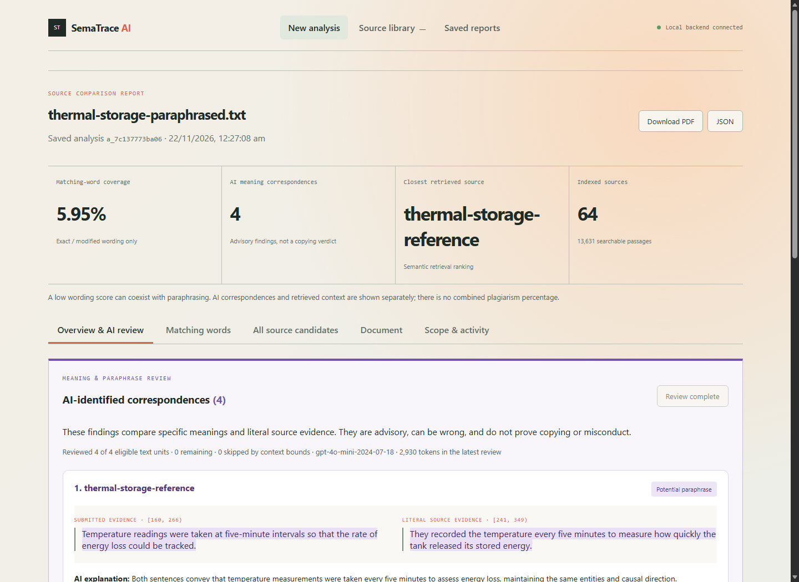

# SemaTrace AI

Document source comparison with local retrieval, word-level alignment and optional AI-assisted paraphrase review.

SemaTrace helps a reviewer answer three questions: **Which sources should I inspect? Which words match? Do these passages express a corresponding meaning?** It keeps those answers separate and shows their source evidence. It reports textual similarities and advisory semantic correspondences rather than determining plagiarism or authorship.



The screenshot uses the included CC0 thermal-storage reference and paraphrase. It demonstrates application behavior, not independently measured semantic accuracy.

## Features

- Upload TXT, text-based PDF or DOCX submissions and reference documents.
- Search immutable references using BM25 and a pinned local MiniLM encoder.
- Find exact and modified wording with seeded word-level Smith-Waterman alignment.
- Calculate overlap-safe matching-word coverage with source/range exclusions.
- Optionally compare passage meanings using structured OpenAI responses and literal-quote validation.
- Optionally capture additional public-web sources through Tavily.
- Investigate selected evidence with bounded LangGraph context, retrieval and experimental reranking tools.
- Retain attribution, highlights, refresh-safe progress, saved reports and PDF/JSON exports.
- Choose private local storage or authenticated cloud storage with Supabase and Pinecone.

## Architecture

```text
References -> immutable source versions -> passages + persistent MiniLM index

Submission -> extraction + position mapping -> BM25 + MiniLM
    -> RRF source shortlist -> lexical alignment -> unique matched-word score
    -> passage candidates -> optional AI review -> grounded advisory findings
    -> SQLite or owned Supabase report -> React evidence views / PDF / JSON

Selected finding -> optional LangGraph investigation -> saved tool trace
```

Retrieval identifies candidates. The lexical scorer validates matching word runs and counts each submitted word once across overlapping references. AI review compares supplied contexts and must return literal quotations that pass identity/offset checks. Valid quotations do not independently verify its interpretation.

React/TypeScript provide the interface; FastAPI serves the API; SQLite stores local evidence and indexes; ONNX Runtime runs local encoders on CPU; Biopython performs alignment; ReportLab generates PDFs. Optional cloud mode uses Supabase Auth/PostgreSQL/private Storage and Pinecone vectors, with a separately hosted Vercel frontend. [Detailed architecture](docs/architecture.md).

## Run locally

Requirements: **Python 3.12**, **Node.js 22.12+** and npm.

```sh
git clone https://github.com/akshat-tumkur/SemaTrace-AI.git
cd SemaTrace-AI
python scripts/start_sematrace.py
```

Open **http://127.0.0.1:8010**. Windows users can also run `./start.ps1`.

The launcher prepares/checks the backend environment, builds the UI, verifies or downloads the pinned encoder, seeds an empty library with 12 licensed Wikipedia revisions, and builds a compatible index. First setup requires internet access. Later local-only comparisons reuse these files. No GPU or PyTorch installation is required for the application.

Stop with `python scripts/stop_sematrace.py` or `./stop.ps1`. Logs are under `.local/runtime/`. [Deployment and troubleshooting](docs/deployment.md) covers configuration, development mode and Docker status.

### Optional external services

Copy `.env.example` to `.env` and add only the services you want:

```dotenv
OPENAI_API_KEY=your_private_key
OPENAI_MODEL=gpt-4o-mini
TAVILY_API_KEY=your_private_key
```

- **AI meaning and paraphrase review** sends selected submission/source excerpts to OpenAI; initially selected when configured.
- **Public-web discovery** sends up to two queries to Tavily and captures up to three pages; initially off.

Turn both off for local-only comparison. Keys remain on the backend. Provider failures are explicit, and calls can incur charges. [Privacy and licensing](docs/privacy.md).

## Try a comparison

1. In **Source library**, add `demo/sources/thermal-storage-reference.txt`.
2. Under **New analysis**, choose `demo/submissions/thermal-storage-paraphrased.txt`.
3. Select local-only or optional AI review, then **Run analysis**.
4. Inspect **Overview & AI review** for paired quotes/differences, **Matching words** for coverage/exclusions, **Document** for quoted highlights, and **All source candidates** for alternatives.
5. Export PDF/JSON or reopen it from **Saved reports**.

The recorded demonstration produced 5.95% matching-word coverage and four advisory AI findings. These measure different things; findings are not a semantic percentage, and outputs can vary. The CC0 fixtures describe a constructed experiment. `demo/product-beta/` provides attributed exact, modified and unrelated controls.

Add your own authorized references for useful domain coverage. `python scripts/provision_product_library.py` expands the Wikipedia starter collection to 60 topics.

## Selected ML research

A computationally constrained adaptation fine-tuned a full RoBERTa-base encoder of approximately 124 million parameters on **30,000 official-training examples**, over **three epochs and 2,814 optimizer updates**. Source-family separation, frozen evaluation identities, adjusted class weighting, mixed precision, dynamic padding and private checkpoint resumption were explicit parts of the protocol.

| Independent sentence evaluation | Precision | Recall | F1 |
| --- | ---: | ---: | ---: |
| TF-IDF baseline | 19.09% | 22.41% | 20.62% |
| MiniLM research baseline | 16.29% | 35.79% | 22.38% |
| Fine-tuned RoBERTa | 35.48% | 47.83% | **40.74%** |

RoBERTa improved F1 but **failed the predetermined automatic-classification acceptance gate**. A separate controlled source-passage check demonstrated no reranking gain: MiniLM Hit@1 was 16/16 versus RoBERTa's 14/16. MiniLM remains the default retriever; the private RoBERTa is an optional experimental ranking comparison, not the application's autonomous semantic classifier.

API-backed review is a distinct advisory method. Nine frozen functional controls passed an actual provider run; they do not establish population precision/recall. No independent accuracy improvement is claimed for that layer.

[Research methodology, results and Colab reproducibility](research/README.md). Restricted datasets, private weights and complete experimental evidence are not distributed here.

## Development and tests

After setup:

```sh
backend/.venv/Scripts/python.exe -m pip install -r backend/requirements-dev.txt
backend/.venv/Scripts/python.exe -m pytest backend/tests -q
```

On macOS/Linux, use `backend/.venv/bin/python`. For the frontend:

```sh
cd frontend
npm ci
npm test
npm run build
npm audit --audit-level=high
```

Tests cover source/index integrity, offsets, alignment, accounting, saved reports, jobs, provider failures and grounding. Optional private-model checks skip when the artifact is absent. `scripts/browser_smoke.py` performs actual Edge journeys with public/CC0 fixtures and separately selected provider execution. [Validation details](docs/deployment.md#validation).

## Limits

- Up to 10 MB, 50,000 normalized characters and 1,000 text units; PDF parsing also caps pages at 100.
- Local retrieval processes every accepted unit. Full-source lexical alignment retains up to 10 sources; each AI review covers up to 48 eligible units, with remaining/skipped scope disclosed.
- Sources must be indexed or successfully captured. There is no Turnitin private-repository access or whole-internet coverage.
- No OCR or original-PDF page-coordinate overlays; DOCX extraction reads paragraphs rather than every Word structure.
- AI interpretation can be wrong. Related writing can rank highly; missing matches do not establish originality.
- Local SQLite mode is private and has no authentication. Public cloud mode requires Supabase sign-in, a shared administrator-managed corpus and isolated private references/reports.
- Docker builds and local runtime checks are verified. Live Render/Vercel validation still requires deploying the services; free hosting has sleep and quota limits. [Cloud setup](docs/deployment.md#free-cloud-hosting).

Source attribution and third-party notices are retained. ARC-Sim-derived weights have noncommercial obligations and are excluded. No project-wide license or commercial redistribution clearance is implied; see [privacy and licensing](docs/privacy.md).
